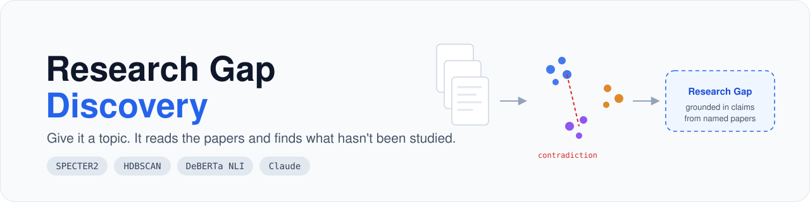
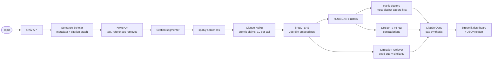

<p align="center">
  
</p>

<p align="center">
  <a href="https://github.com/Shubham-Dipak-Wani/Automated-Research-Gap-Discovery-System/actions/workflows/ci.yml"></a>
  
  
  
  <br>
  
  
  
  
  
  
</p>

<p align="center">
  <b>Type a research topic. The system pulls papers from arXiv and Semantic Scholar, breaks them into atomic claims,<br>
  groups the claims by meaning, flags where papers contradict each other, and writes up what's still unstudied,<br>
  with every gap traced back to the claims and papers behind it.</b>
</p>

> A team project for the NLP course at USC, spring 2026. I led the v2 rebuild described below. Original team repository: [JaanakiDave11/NLP-project](https://github.com/JaanakiDave11/NLP-project).

---

## Contents

- [What it produces](#what-it-produces)
- [Pipeline](#pipeline)
- [How each stage works](#how-each-stage-works)
- [Design decisions](#design-decisions)
- [v1 → v2](#v1--v2)
- [Project structure](#project-structure)
- [Getting started](#getting-started)
- [Configuration](#configuration)
- [Evaluation](#evaluation)
- [Testing and CI](#testing-and-ci)
- [Limitations and roadmap](#limitations-and-roadmap)

---

## What it produces

Three kinds of gaps, each with the claims and papers it rests on:

| Type | Comes from | Example question it answers |
| --- | --- | --- |
| **Open question** | A cluster of related claims, ideally from several papers | "Everyone measures X on short inputs. What happens on long ones?" |
| **Contradiction** | Claim pairs that NLI says disagree | "Paper A says retrieval reduces hallucination, paper B says it doesn't. What experiment would settle it?" |
| **Limitation** | Claims close in meaning to phrases like *"remains challenging"* or *"future work should address"* | "Three papers all say multilingual retrieval is unsolved." |

A real gap from [`examples/sample_results.json`](examples/sample_results.json) (5 papers on "retrieval augmented generation"):

> **Research Gap:** While AR-RAG establishes that patch-level, step-wise k-nearest neighbor retrieval outperforms prior static, whole-image retrieval conditioning, the claims do not address how to manage the computational cost, latency, and retrieval-index scalability introduced by performing context-aware retrieval at every autoregressive generation step…

---

## Pipeline



The CLI (`main.py`) and the web app (`app.py`) both call the same stage functions in [`pipeline.py`](pipeline.py), so they can't drift apart.

---

## How each stage works

**1. Collect papers.** arXiv search (with backoff on rate limits), then Semantic Scholar adds citation counts, year and venue, and follows each paper's references to download the most-cited ones that are also on arXiv. Five seed papers often become ten or more. Downloads go to a temporary file first, so a broken download is never mistaken for a cached PDF.

**2. Parse.** PyMuPDF extracts the text, and the bibliography is cut at the **last line that is only a "References" heading**. Sections are found from headings on their own line ("3.2 Results"). A paper with no recognizable headings is kept as one body section instead of being dropped, and an unreadable PDF is skipped with a warning instead of stopping the run.

**3. Extract claims (Claude Haiku).** Sentences go 10 per call, with a cached system prompt of 65 worked examples covering compound claims, metadata, pronouns, ablations, limitations and table captions. `SENTENCE N:` markers map every claim back to its sentence, section and paper:

```json
{"text": "RAG improves factual accuracy by 18% compared to standard generation.",
 "paper_title": "Retrieval-Augmented Generation for Knowledge-Intensive NLP",
 "section": "results",
 "source_sentence": "Our experiments show RAG improves factual accuracy by 18%..."}
```

**4. Embed (SPECTER2).** It was trained on scientific citation pairs, so it knows "RAG" and "retrieval-augmented generation" mean the same thing.

**5. Cluster (HDBSCAN).** No need to pick *k*, and outliers are labeled noise instead of being forced into a topic. Clusters are tracked as **claim indices**, so claims and embeddings can't fall out of sync.

**6. Find contradictions (DeBERTa-v3 NLI).** Inside each cluster, only pairs with cosine similarity between 0.7 and 0.9 are tested. Below that they're about different things; above it they're near-duplicates. NLI is run in **both directions** (it's asymmetric), and confidence must exceed 0.7. Label order comes from the model config, never a hardcoded list.

**7. Find limitations.** Each claim is compared with 8 seed phrases ("remains challenging", "future work should address", "current methods fail to"…). Matches are re-clustered so recurring limitations group together.

**8. Write gaps (Claude Opus, adaptive thinking).** Clusters are **ranked by how many different papers they span**, then by size, and only the top ones are sent (12 topic gaps and 5 limitation gaps by default). Each prompt carries up to 5 claims with their paper and section, and every output is checked to start with `Research Gap:`.

---

## Design decisions

| Decision | Why |
| --- | --- |
| 10 sentences per Haiku call + cached prompt | 10× fewer calls; the 65-example prompt costs almost nothing after the first call |
| Claims, not sentences, as the unit | One sentence often holds two facts; splitting them makes clustering and NLI precise |
| SPECTER2 over general embeddings | Trained on scientific citations, so it understands field vocabulary and abbreviations |
| HDBSCAN over K-means | No *k* to guess, and noise is discarded cleanly |
| Cosine window before NLI | Cuts O(n²) NLI calls down to the pairs where disagreement is plausible |
| Rank and cap the clusters sent to Opus | A cluster spanning several papers says more about the field. Without a cap, 5 papers produced 210 gaps (and 210 Opus calls) |
| Shared `pipeline.py` | The CLI and the UI used to have separate copies of the stages; now there's one |
| Heavy imports done lazily | Tests and `--help` run without torch, spaCy or the models installed |

---

## v1 → v2

| Component | v1 | v2 |
| --- | --- | --- |
| Claim extraction | FLAN-T5-small, then Mistral 7B, one call per sentence | Claude Haiku, 10 sentences per call, 65-example cached prompt |
| Gap generation | FLAN-T5-base + rules | Claude Opus with adaptive thinking |
| Embeddings | SPECTER | SPECTER2 |
| Sources | arXiv | arXiv + Semantic Scholar citation graph |
| Limitations | none | Seed-query retriever + re-clustering |
| UI | Plain Streamlit text | Plotly charts, tabbed gap explorer, paper explorer, live progress |

**Hardening in this release.** A real test suite (the test files used to be empty) turned up bugs, which are now fixed and covered:

- **Papers were cut short.** The bibliography was removed by splitting on the *first* "references" anywhere, so "…with references to prior work" in an introduction dropped the rest of the paper.
- **Real claims were thrown away.** The metadata filter matched substrings, so claims containing "doing" (has "doi") or "nonetheless" (has "none") were discarded.
- **Papers without standard headings contributed nothing.** They're now kept as one section.
- **The SciFact evaluation couldn't run.** It called `.max(dim=1)` on BERTScore's 1-D output and read dataset fields that don't exist. It's rewritten against the real schema (below).
- **One corrupt PDF stopped the whole run.** It's now skipped with a warning.

---

## Project structure

```text
├── pipeline.py               Shared stages used by the CLI and the web app
├── main.py                   CLI: python main.py "topic" --papers 5
├── app.py                    Streamlit dashboard
├── config/settings.py        Every model name, threshold and limit in one place
├── ingestion/                arXiv client, Semantic Scholar client
├── parsing/                  PDF text + references removal, section segmenter
├── claims/                   Claude claim extractor, limitation retriever
├── embedding/                SPECTER2 embedder
├── clustering/               HDBSCAN wrapper, index grouping and cluster ranking
├── nli/                      DeBERTa engine, pair selection and contradiction search
├── gap_generation/           Claude Opus gap writer and prompts
├── evaluation/               SciFact harness and metrics
├── examples/                 Output from a real run
├── tests/                    35 offline tests
└── .github/workflows/ci.yml  Tests on every push
```

---

## Getting started

```bash
git clone https://github.com/Shubham-Dipak-Wani/Automated-Research-Gap-Discovery-System.git
cd Automated-Research-Gap-Discovery-System

python -m venv venv
source venv/bin/activate              # Windows: venv\Scripts\activate
pip install -r requirements.txt
python -m spacy download en_core_web_sm

cp .env.example .env                  # add ANTHROPIC_API_KEY
```

**Web app**

```bash
streamlit run app.py                  # http://localhost:8501
```

Enter a topic, choose how many papers to analyze, and press **Run Analysis**. The sidebar shows each stage as it completes, and results can be exported as JSON.

**Command line**

```bash
python main.py "retrieval augmented generation" --papers 5
```

Results are saved to `data/results.json`. The first run downloads SPECTER2 and DeBERTa (about 1 GB).

---

## Configuration

Everything lives in [`config/settings.py`](config/settings.py):

| Setting | Default | Meaning |
| --- | --- | --- |
| `CLAUDE_CLAIM_MODEL` / `CLAUDE_GAP_MODEL` | Haiku / Opus | Extraction and synthesis models |
| `CLAIM_BATCH_SIZE` | 10 | Sentences per extraction call |
| `MIN_SENTENCE_LENGTH` / `MIN_CLAIM_LENGTH` | 40 / 30 chars | Shorter text is skipped |
| `HDBSCAN_MIN_CLUSTER_SIZE` / `EPSILON` | 2 / 0.8 | Cluster granularity |
| `COSINE_SIM_MIN` / `COSINE_SIM_MAX` | 0.7 / 0.9 | NLI candidate window |
| `NLI_CONFIDENCE_THRESHOLD` | 0.7 | Minimum confidence for a contradiction |
| `LIMITATION_SIMILARITY_THRESHOLD` | 0.5 | Seed-query match threshold |
| `MAX_TOPIC_GAPS` / `MAX_LIMITATION_GAPS` | 12 / 5 | Opus calls per run |
| `MAX_CLAIMS_PER_GAP` | 5 | Claims shown to Opus per gap |

---

## Evaluation

[`evaluation/evaluator.py`](evaluation/evaluator.py) checks two stages against [SciFact](https://huggingface.co/datasets/allenai/scifact), where experts paired claims with evidence sentences from paper abstracts:

| Check | Setup | Metric |
| --- | --- | --- |
| **Contradiction detection** | Premise = the evidence sentences, hypothesis = the claim. SUPPORT → entailment, CONTRADICT → contradiction, no evidence → neutral | Macro F1, plus contradiction precision, recall and F1 |
| **Claim extraction** | Extract claims from the evidence sentences of SUPPORT examples | Recall: how often the expert claim is recovered (BERTScore ≥ 0.8) |

```bash
pip install bert-score datasets
python -m evaluation.evaluator --nli 300 --claims 100
```

Extraction is measured as recall only, because an abstract holds many valid claims that SciFact doesn't list. Results are written to `data/evaluation_results.json`. Benchmark numbers aren't reported here yet; running the harness is the next step.

---

## Testing and CI

```bash
pip install -r requirements-dev.txt
python -m pytest            # 35 tests, ~3 s, no models, API key or network
```

| File | Covers |
| --- | --- |
| `test_parsing.py` | References removal (mid-sentence mentions, numbered and repeated headings), whitespace, section detection and the no-heading fallback |
| `test_claims.py` | Mapping batch output to sentences, the metadata filter (including the substring bug), API failures, batching, limitation retrieval |
| `test_pipeline.py` | Index grouping with gappy cluster ids, cluster ranking, the cosine window, two-way NLI, skipping bad PDFs, gap planning and progress, Opus output handling |
| `test_ingestion_and_metrics.py` | arXiv feed parsing and retries, the BERTScore matrix, claim F1 and recall, NLI F1, joining SciFact claims to abstracts |

Models and APIs are replaced by small fakes, so CI installs only numpy, scikit-learn and pytest.

---

## Limitations and roadmap

- Section detection relies on common headings. Unusual ones ("Our Approach") fall into the neighboring section.
- Semantic Scholar allows about 100 requests a minute without a key, which large runs can hit.
- Embeddings are recomputed on every run.
- [ ] Run the SciFact harness and publish the numbers
- [ ] Cache embeddings and claims per paper
- [ ] Human rating of gaps for novelty, groundedness and actionability, compared with a plain-LLM baseline

---

## Team and credits

Team project for the NLP course at USC (spring 2026). The original team repository is [JaanakiDave11/NLP-project](https://github.com/JaanakiDave11/NLP-project).

**My part:** the v2 rebuild. I moved claim extraction and gap generation to the Claude API, added the Semantic Scholar citation graph, the limitation retriever, the SciFact evaluation and the Streamlit dashboard, and did the testing and hardening in this release.

Released under the [MIT License](LICENSE).

<p align="center">
  <b>Shubham Wani</b> · M.S. Computer Science, USC<br>
  <a href="https://www.linkedin.com/in/shubham-dipak-wani">LinkedIn</a> ·
  <a href="https://shubham-dipak-wani.netlify.app/">Portfolio</a>
</p>
